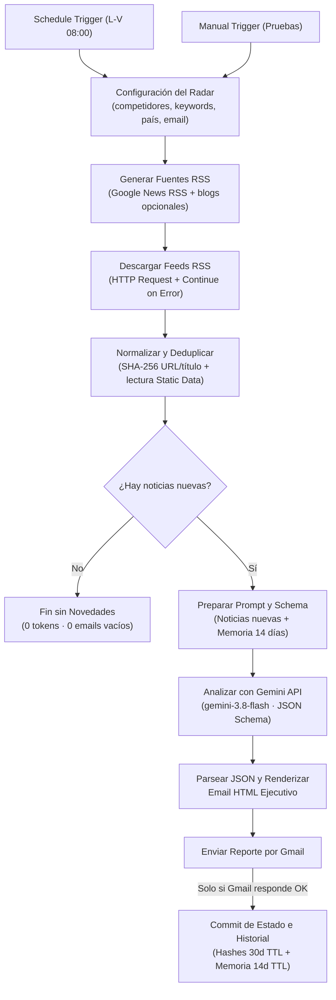

# Radar Competitivo Diario para E-commerce & Retail (n8n + Gemini + Gmail)

Automatización lista para importar en **n8n** que monitorea competidores y tendencias del sector en horarios programados, elimina duplicados con **idempotencia real (SHA-256 + commit posterior a la entrega)**, compara las novedades contra una **memoria histórica de 14 días** usando **Gemini 3.8 Flash** para detectar cambios relevantes y entrega un **reporte ejecutivo HTML por Gmail**.

> **Valor técnico principal:** resuelve de forma *plug-and-play* (cero bases de datos externas) el problema clásico de las automatizaciones recurrentes: deduplicación por hash, tolerancia a fallos sin pérdida de eventos, corte limpio cuando no hay novedades y detección de cambios frente a días anteriores.

---

## Arquitectura del Flujo



---

## Características Clave

* **100% Parametrizable en un solo nodo:** cambia competidores, palabras clave, país/idioma (`hl`, `gl`, `ceid`) y correo destinatario desde **`Configuración del Radar`** sin tocar lógica interna.
* **Demo lista para E-commerce / Retail:** preconfigurada para monitorear **Shopify**, **Tiendanube** y **Mercado Libre**, más 3 ejes del sector (*E-commerce LATAM*, *Logística Última Milla* y *Pagos y Checkout*).
* **Deduplicación en doble capa (SHA-256 puro en JS):**
  * Normaliza URLs eliminando parámetros de tracking (`utm_*`, `fbclid`, `gclid`, etc.).
  * Detecta notas sindicadas con el mismo titular en distintos medios y fusiona entidades cuando una noticia menciona a más de un competidor.
  * Implementa SHA-256 sin `require('crypto')` para funcionar en **n8n Cloud** y **Docker** sin configuraciones extra.
* **Detección de cambios relevantes (*Delta Detection*):** guarda los hechos clave de los últimos 14 días y le pide a Gemini destacar una alerta visual en el correo **solo cuando ocurre un cambio importante** (ej. un piloto que pasa a lanzamiento oficial o un ajuste de comisiones/precios).
* **Idempotencia real (*Commit-After-Delivery*):** los hashes solo se guardan en `Static Data` **después** de que Gmail confirma el envío. Si Gemini o Gmail fallan, ninguna noticia se pierde.
* **Ventana inteligente de lunes:** analiza las últimas **24 horas** de martes a viernes y amplía automáticamente a **72 horas** los lunes para cubrir el fin de semana.
* **Cero dependencias externas:** usa almacenamiento interno de n8n con poda automática por TTL (30 días para hashes, 14 días para memoria histórica).

---

## Estructura del Repositorio

```text
radar_de_noticias_n8n/
├── workflows/
│   └── radar-competitivo-ecommerce.json   # Workflow listo para importar en n8n
├── docs/
│   ├── arquitectura-idempotencia.md       # Diseño técnico de deduplicación, TTL y Static Data
│   └── ejemplo-reporte.html               # Vista previa real del correo HTML ejecutivo
├── prompts/
│   └── gemini-radar-prompt.md             # System prompt y JSON Schema de Gemini
├── scripts/
│   └── test-workflow-logic.mjs            # Suite de pruebas unitarias (Node.js, cero dependencias)
├── LICENSE
└── README.md
```

---

## Instalación y Configuración en n8n (5 minutos)

### 1. Importar el workflow
1. Abre tu instancia de n8n (Cloud o self-hosted).
2. Ve a **Workflows → Import from File** y selecciona [`workflows/radar-competitivo-ecommerce.json`](workflows/radar-competitivo-ecommerce.json).

### 2. Configurar credenciales (sin secretos hardcodeados)
Necesitas crear 2 credenciales en n8n y asignarlas en los nodos correspondientes:

1. **Gemini API Key** → en el nodo **`Analizar con Gemini API`**:
   * Tipo de credencial: **Header Auth** (`Generic Credential Type`).
   * **Name:** `x-goog-api-key`
   * **Value:** tu API Key de [Google AI Studio](https://aistudio.google.com/apikey).
2. **Gmail OAuth2** → en el nodo **`Enviar Reporte por Gmail`**:
   * Conecta tu cuenta de Google Workspace o Gmail mediante la credencial estándar **Gmail OAuth2** de n8n.

### 3. Personalizar tu radar
Abre el nodo **`Configuración del Radar`** y ajusta el JSON según tu empresa:

```json
{
  "radar_name": "Radar Competitivo E-commerce & Retail",
  "recipient_email": "equipo-direccion@tuempresa.com",
  "gemini_model": "gemini-3.8-flash",
  "region": {
    "hl": "es-419",
    "gl": "PY",
    "ceid": "PY:es-419"
  },
  "competitors": [
    { "name": "Shopify", "query": "\"Shopify\" (ecommerce OR tienda OR pagos OR precios)", "blog_rss": "" },
    { "name": "Tiendanube", "query": "\"Tiendanube\" OR \"Nuvemshop\"", "blog_rss": "" },
    { "name": "Mercado Libre", "query": "\"Mercado Libre\" (ecommerce OR envíos OR comisiones)", "blog_rss": "" }
  ]
}
```

> **Tip regional:** viene preconfigurado para Paraguay (`PY`). Para Argentina cambia `gl` a `"AR"` y `ceid` a `"AR:es-419"`; para México `"MX"` / `"MX:es-419"`; para Colombia `"CO"` / `"CO:es-419"`; para España `"ES"` / `"ES:es"`.

### 4. Probar y activar
* Ejecuta una prueba manual desde **`Manual Trigger (Pruebas)`** para verificar la llegada del correo HTML.
* **Importante sobre `Static Data`:** en n8n, `workflowStaticData` persiste entre ejecuciones únicamente cuando el workflow está **Activo (Producción)**. Actívalo para que el control de duplicados y la memoria de 14 días operen de forma continua. *(Ver más detalles y alternativas con n8n Data Tables o Supabase en [`docs/arquitectura-idempotencia.md`](docs/arquitectura-idempotencia.md)).*

---

## Vista Previa del Reporte

Puedes abrir [`docs/ejemplo-reporte.html`](docs/ejemplo-reporte.html) directamente en tu navegador para ver un ejemplo real generado por el nodo renderizador del workflow, incluyendo el bloque condicional de **Cambios Relevantes vs. Reportes Anteriores**.

---

## Verificación Automatizada de la Lógica

El repositorio incluye una suite de pruebas en Node.js (sin dependencias externas) que extrae y ejecuta el código real de todos los nodos `Code` dentro de `workflows/radar-competitivo-ecommerce.json` para validar:
* Integridad del grafo de nodos y ausencia de credenciales hardcodeadas.
* Exactitud del algoritmo SHA-256 puro en JS contra `node:crypto`.
* Normalización de URLs, parsing RSS 2.0 + Atom y fusión de duplicados intra-corrida.
* Deduplicación histórica, poda por TTL y *short-circuit* cuando no hay novedades.
* Sanitización XSS/URLs en el correo HTML y *commit* posterior al envío de Gmail.

```bash
node scripts/test-workflow-logic.mjs
```

---

## Licencia

Distribuido bajo licencia **MIT**. Libre para adaptar a cualquier industria o proyecto comercial.
