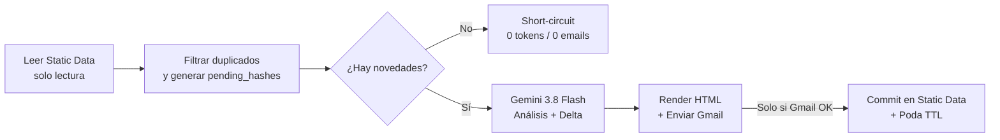

# Arquitectura de Idempotencia, Deduplicación y Memoria Histórica

Este documento detalla cómo el workflow resuelve los cuatro problemas clásicos de un radar de noticias automatizado en ejecuciones recurrentes:

1. **Duplicados entre ejecuciones** (la misma noticia vuelve a aparecer en el feed RSS durante 24–72 horas).
2. **Duplicados dentro de la misma ejecución** (una noticia menciona a dos competidores o entra por dos keywords distintas).
3. **Pérdida de noticias ante fallos parciales** (si Gemini o Gmail fallan, las noticias no deben marcarse como "ya enviadas").
4. **Ceguera histórica** (resumir cada día de forma aislada sin detectar cambios relevantes respecto a días anteriores).

---

## 1. Deduplicación en dos capas (sin dependencias externas)

Google News RSS y los blogs corporativos presentan dos desafíos concretos:
* Las URLs suelen incluir parámetros de tracking variables (`utm_source`, `utm_medium`, `fbclid`, `gclid`, `oc`, etc.).
* Distintos medios publican el mismo cable de prensa con URLs diferentes pero el mismo titular.

Por eso el nodo **`Normalizar y Deduplicar (SHA-256 + Estado)`** calcula dos huellas determinísticas usando **SHA-256 en JavaScript puro** (sin `require('crypto')`, garantizando compatibilidad total con n8n Cloud, Docker y task runners sin habilitar variables de entorno extra):

| Capa | Entrada normalizada | Qué evita |
| :--- | :--- | :--- |
| **`article_hash`** | URL limpia (host en minúsculas, sin `utm_*`, sin fragmento `#`, sin `/` final) o `guid` | Reprocesar el mismo artículo aunque cambien parámetros de tracking |
| **`title_fingerprint`** | Titular sin sufijo de medio (`- Infobae`, `\| Forbes`), sin tildes ni signos (si largo ≥ 20 caracteres) | Reprocesar notas sindicadas duplicadas con URL distinta |

### Fusión intra-corrida
Si una misma noticia aparece en la búsqueda de **Shopify** y en la de **Tiendanube** durante la misma ejecución, el algoritmo no la descarta ciegamente ni la envía dos veces: **fusiona ambas etiquetas** en `matched_entities: ["Shopify", "Tiendanube"]` y envía un único artículo a Gemini.

---

## 2. Idempotencia real: Commit posterior a la entrega (*Commit-After-Delivery*)

Un error habitual en flujos de n8n es guardar los hashes como "vistos" **antes** de llamar a la IA o enviar el correo. Si el envío falla (timeout de Gmail, cuota de API, caída temporal), esas noticias se pierden para siempre.

Este workflow separa la **lectura** de la **escritura** del estado:



* Si **Gemini falla** → no hay commit → la próxima ejecución reintenta con las mismas noticias.
* Si **Gmail falla** → no hay commit → ninguna noticia se pierde.
* Si **no hay noticias nuevas** → el nodo IF corta el flujo (`Short-circuit`) → no se consumen tokens ni se envía un correo vacío.

---

## 3. Memoria histórica y detección de cambios relevantes (*Delta Detection*)

Además de `seen_hashes` y `seen_titles`, el estado interno mantiene una memoria compacta llamada `recent_events`:

```json
{
  "seen_hashes": {
    "a1b2c3...": "2026-11-24T11:00:05.000Z"
  },
  "seen_titles": {
    "9f8e7d...": "2026-11-24T11:00:05.000Z"
  },
  "recent_events": [
    {
      "date": "2026-11-22",
      "recorded_at": "2026-11-22T11:00:12.000Z",
      "entidad": "Mercado Libre",
      "categoria": "Pricing",
      "hecho": "Anunció pruebas piloto de nueva escala de comisiones para vendedores Full en Argentina."
    }
  ],
  "last_successful_run": {
    "timestamp": "2026-11-24T11:00:15.000Z",
    "new_items_sent": 9,
    "changes_detected": 1
  }
}
```

En cada corrida:
1. Se envían a Gemini **las noticias nuevas del día** + **los hechos compactos de los últimos 14 días** (`recent_events`).
2. Gemini compara ambos bloques y llena `cambios_relevantes` **únicamente** si detecta una evolución sustancial (por ejemplo: un piloto que pasa a lanzamiento oficial, un ajuste de precios/comisiones que modifica uno anterior, una escalada o desmentida).
3. El correo HTML muestra un bloque destacado de alerta **solo cuando `cambios_relevantes` tiene elementos**; en días normales la sección se oculta para mantener el reporte limpio.

---

## 4. Poda automática (TTL) para estado acotado

Para evitar que `workflowStaticData` crezca indefinidamente:
* `seen_hashes` y `seen_titles` se podan automáticamente al superar **`dedup_ttl_days`** (30 días por defecto).
* `recent_events` se poda automáticamente al superar **`memory_ttl_days`** (14 días) y se acota a un máximo de **`memory_max_events`** (30 hechos más recientes).

---

## 5. Nota importante sobre `Static Data` vs `n8n Data Tables`

En n8n, `$getWorkflowStaticData('global')` tiene una particularidad oficial importante:
* **En producción (workflow activo con Schedule Trigger):** el estado persiste automáticamente en la base interna de n8n entre ejecuciones.
* **En ejecuciones manuales desde el editor ("Test workflow"):** n8n **no persiste** los cambios hechos en `workflowStaticData` entre corridas de prueba manuales.

### Recomendaciones según tu entorno
* **Uso estándar / portafolio Plug & Play:** deja `Static Data` tal cual (cero dependencias externas, funciona en cualquier versión de n8n). Al activar el workflow en producción, la persistencia funciona de forma nativa.
* **Si usas n8n v1.113+ y quieres inspeccionar el historial visualmente (incluso en pruebas manuales):** puedes reemplazar los nodos de lectura/commit de `Static Data` por el nodo nativo **n8n Data Tables** con dos tablas (`seen_articles` y `recent_events`).
* **Si necesitas escalar a decenas de radares o múltiples clientes:** migra el almacenamiento de lectura/commit a **PostgreSQL / Supabase** manteniendo exactamente el mismo contrato de `article_hash`, `title_fingerprint` y `recent_events`.
